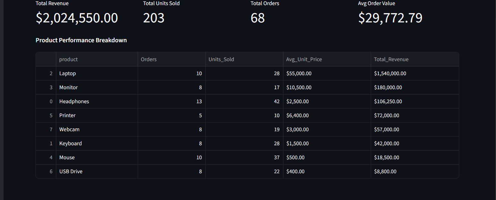
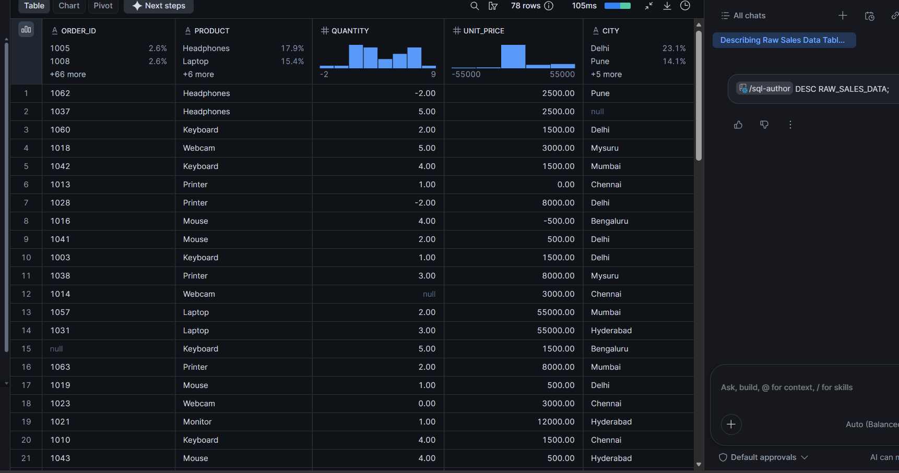
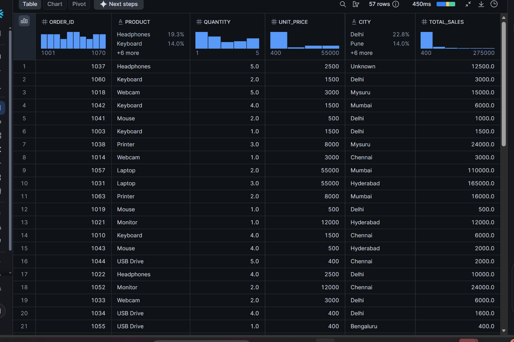
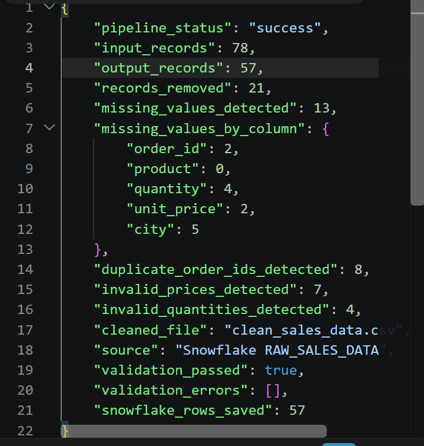
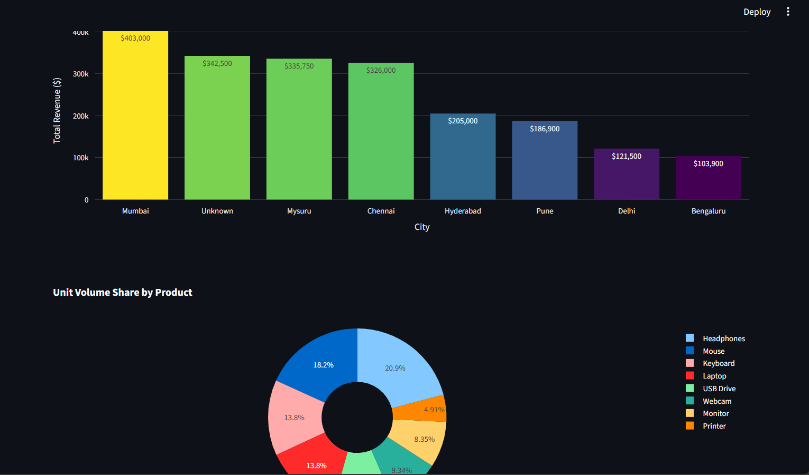
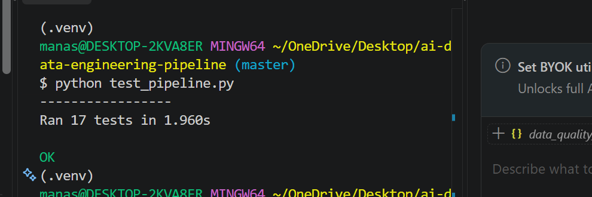

# AI Data Studio — Sales Data Engineering Pipeline

A Python-based sales data pipeline that reads raw sales records from Snowflake, cleans and validates the data, identifies data-quality issues, stores cleaned records, and produces reporting outputs for analysis and visualization.

> **Repository note:** The supplied `AI_DATA_STUDIO.zip` contains screenshots only. Place these images in a folder named `screenshots/` in the GitHub repository so the README images below display correctly.

## Project highlights

- Extracts raw sales data from Snowflake.
- Cleans and validates sales records, including missing values, duplicate order IDs, invalid prices, and invalid quantities.
- Writes cleaned data to a Snowflake clean table.
- Produces local summary outputs, including grouped sales by city/product and a JSON data-quality report.
- Uses application logging for pipeline activity and diagnostics.
- Includes automated pipeline tests. The captured terminal screenshot shows **17 tests passing** in the displayed run.
- Includes dashboard/visualization screenshots for exploring sales totals, product performance, and geographic summaries.

## Screenshots

### Sales dashboard



### Raw sales data in Snowflake



### Cleaned sales data



### Data-quality report



### Visual representations



### Automated pipeline tests



## Technology

- Python
- pandas
- Snowflake Connector for Python
- python-dotenv
- unittest
- Streamlit / visualization components, if included in the application files

Check `requirements.txt` in the project for the definitive dependency list.

## Project structure

Keep the files that are present in your working project. A typical layout for this repository is:

```text
AI_DATA_STUDIO/
├── ai_data_app.py
├── main.py
├── pipeline.py
├── transform_data.py
├── logging_config.py
├── snowflake_test_connection.py
├── create_sample_data.py
├── test_pipeline.py
├── test_local_cleaning.py
├── requirements.txt
├── .env.example
├── .gitignore
├── data/
├── logs/                 # generated logs; normally do not commit
└── screenshots/
    ├── RAW_DATA.png
    ├── CLEANED_DATA.png
    ├── DASHBOARD.png
    ├── QUALITY_REPORT.png
    ├── VISUAL_REP.png
    └── PIPELINE_TEST.png
```

Some filenames above were identified from the project workflow/screenshots; **do not create empty placeholder files** for files that are not actually in your project.

## Setup

1. Install Python (use the version supported by your project dependencies).
2. Clone your repository and open its folder in a terminal.
3. Create and activate a virtual environment.

   **Windows PowerShell:**
   ```powershell
   py -m venv .venv
   .\.venv\Scripts\Activate.ps1
   ```

   **Windows Command Prompt:**
   ```bat
   py -m venv .venv
   .venv\Scripts\activate.bat
   ```

4. Install dependencies:
   ```bash
   python -m pip install --upgrade pip
   pip install -r requirements.txt
   ```
5. Create a local `.env` file based on `.env.example` and fill in your own Snowflake connection values. Never commit `.env`.
6. Confirm the Snowflake database, schema, warehouse, permissions, and authentication configuration match your own account before running the pipeline.

## Snowflake configuration

The project configuration uses these environment-variable names:

```dotenv
SNOWFLAKE_ACCOUNT=
SNOWFLAKE_USER=
SNOWFLAKE_WAREHOUSE=
SNOWFLAKE_DATABASE=AI_DATA_ENGINEERING_DB
SNOWFLAKE_SCHEMA=RAW
```

The project has used these tables:

- Raw input: `AI_DATA_ENGINEERING_DB.RAW.RAW_SALES_DATA`
- Clean output: `AI_DATA_ENGINEERING_DB.RAW.CLEAN_SALES_DATA`

Authentication has been configured for OAuth authorization-code sign-in in the development setup. Follow the authentication settings in your actual `pipeline.py` / connection module; do not add passwords, access tokens, client secrets, or other credentials to this README or to GitHub.

## Run the project

Use the command that matches the file you want to run and the entry point implemented in your local copy. For example:

```bash
python main.py
```

If the Streamlit interface is part of this repository, launch it with:

```bash
streamlit run ai_data_app.py
```

Run the Snowflake connection check, if provided:

```bash
python snowflake_test_connection.py
```

## Run tests

```bash
python -m unittest test_pipeline.py
```

To run the full test discovery suite:

```bash
python -m unittest discover -v
```

The `PIPELINE_TEST.png` screenshot records a successful run with 17 tests. Results can vary depending on the current code, environment, and Snowflake access.

## Example outputs

Depending on the pipeline configuration, generated outputs can include:

- Cleaned sales data
- Sales summaries grouped by city and product
- A JSON data-quality report
- Application logs

Generated files may be written under `data/` or `logs/`. Check the output paths in the source code before documenting exact filenames.

## GitHub upload checklist

**Upload** the source code needed to run the project, `requirements.txt`, `.gitignore`, `.env.example` with blank/non-secret values, the README, and the six screenshots in `screenshots/`. Include only small, non-sensitive sample data if it is yours to share.

**Do not upload**:

- `.env` or any credentials, tokens, private keys, or account secrets
- `.venv/` or other virtual-environment folders
- `__pycache__/`, `.pyc` files, or temporary files
- Logs containing private data or credentials
- Real customer/business data that you are not authorized to publish
- Large generated outputs or model/cache files unless the project specifically requires them

Before pushing, check `git status` and review the files being committed.

## Future improvements

- Add a reproducible sample dataset with clearly fictional data.
- Document the exact schema and output filenames from the current source code.
- Add a pipeline architecture diagram and a sample quality report with sensitive values removed.
- Add CI to run the test suite automatically on each push.
-
